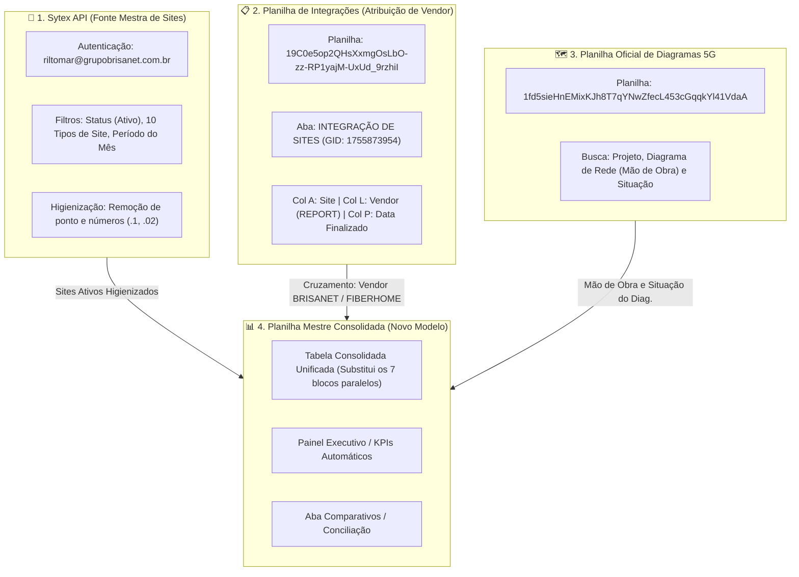

# 📐 Arquitetura da Nova Estratégia de Integrações & Diagramas 5G

> [!NOTE]
> Documento de planejamento e modelagem de dados da nova estratégia para o módulo de integração de sites 5G, cruzamento Sytex e consolidação em planilha única.

---

## 1. Visão Geral das Fontes de Dados Mapeadas



---

## 2. Diagnóstico da Estrutura Atual da Planilha (`NOV/2026`)

Ao analisar a planilha de destino atual (`1_QIjeOwBFqW5BzEEq4OCCIWKFG7O8-YONGIoH5R9za8` / aba `NOV/2026`), identificamos que ela utiliza **7 tabelas paralelas lado a lado**:

| Bloco | Colunas | Categoria | Conteúdo |
| :---: | :---: | :--- | :--- |
| **1** | **C até F** | `Integrador - Huawei` | TICKET, SITE, Mão de Obra, Servi.Terceiro |
| **2** | **H até I** | `Tecnologia - Outros Vendors` | SITE, Mão de Obra (FIBERHOME) |
| **3** | **K até L** | `Tecnologia - Integrado por nós` | SITE, Mão de Obra (BRISANET / HUAWEI) |
| **4** | **N até O** | `Total Tecnologia` | SITE, Mão de Obra (Consolidação) |
| **5** | **Q até T** | `Expansão: Redes Móveis - RF` | Projeto, SITE, Mão de Obra, Situação do Diag. |
| **6** | **V até Y** | `Expansão: Redes Móveis - NOC` | Projeto, SITE, Mão de Obra, Situação do Diag. |
| **7** | **AA até AB** | `Total Expansão` | SITE, Mão de Obra (Consolidação) |

### ⚠️ Principais Ineficiências desse Modelo Atual:
1. **Conflito de Altura de Linhas:** Como as listas possuem tamanhos diferentes (ex.: 54 sites em Brisanet, 21 em Fiberhome, 4 em RF), as tabelas menores ficam com espaços em branco vazios desnecessários.
2. **Incompatibilidade com Filtros Nativos:** Aplicar um filtro em uma coluna (ex.: filtrar um estado na Coluna C) oculta automaticamente as linhas das outras 6 tabelas da aba.
3. **Totalizadores e Fórmulas Rígidas:** As colunas N-O e AA-AB apenas duplicam dados de outras colunas com fórmulas manuais suscetíveis a quebra.
4. **Dificuldade de Integração e BI:** Tabelas lado a lado não podem ser consumidas facilmente pelo Looker Studio, Power BI ou tabelas dinâmicas.

---

## 3. Nova Distribuição Proposta para a Planilha

Para modernizar o fluxo e atender ao requisito de **eliminar o volume de planilhas e simplificar a gestão**, propomos a seguinte distribuição:

### 🏛️ Modelo 1: Tabela Operacional Única (Recomendado)
Todas as demandas do mês residem em **uma única tabela relacional contínua**, onde cada linha representa uma integração/chamado com todos os seus atributos:

```
+----+-------------+----------+-----------+------------+--------------------+-----------+--------------------+---------------+--------------------+
| ID | Data Fim    | Frente   | Site      | Tipo Site  | Vendor / Resp.     | Projeto   | Mão de Obra (Diag) | Situação Diag | Status Conciliação |
+----+-------------+----------+-----------+------------+--------------------+-----------+--------------------+---------------+--------------------+
|  1 | 08/10/2026  | Tec      | VRZ0004   | Concreto   | FIBERHOME          | -         | 4023989 0020       | OK            | Conciliado         |
|  2 | 10/10/2026  | Tec      | JFT0006   | Greenfield | BRISANET           | -         | 4023987 0020       | OK            | Conciliado         |
|  3 | 14/10/2026  | Exp. RF  | MRO0005   | Rooftop    | BRISANET           | EXP-WL... | 4023991 0020       | Em Elaboração | Conciliado         |
+----+-------------+----------+-----------+------------+--------------------+-----------+--------------------+---------------+--------------------+
```

#### Dicionário de Campos da Tabela Única:
* **Período / Data Finalização:** Extraído da Coluna P da planilha de integração.
* **Frente / Categoria:** `Tecnologia (Integrador)`, `Tecnologia (Outros Vendors)`, `Tecnologia (Integrado por nós)`, `Expansão RF`, `Expansão NOC`.
* **Código do Site:** Código higienizado via Regex (sem `.1`, `.02`).
* **Tipo de Site:** Classificação vinda da API Sytex (`Greenfield`, `Poste de Concreto`, `Rooftop`, etc.).
* **Vendor / Report:** Classificação da Coluna L da planilha de integração (`BRISANET`, `FIBERHOME`, `HUAWEI`).
* **Projeto:** Código do projeto associado (para frentes de Expansão).
* **Mão de Obra (Diagrama de Rede):** Código do diagrama retornado da base de diagramas 5G.
* **Situação do Diagrama:** Status oficial do diagrama (`OK`, `Pendente`, `Em elaboração`, etc.).
* **Status da Conciliação:** Indicador de validação (`✅ Conciliado (Sytex + Planilha)`, `⚠️ Apenas no Sytex`, `⚠️ Sem Vendor`).

---

### 📊 Painel de Indicadores Automático (Topo da Aba ou Aba Resumo)
No topo da mesma aba (linhas 1 a 4 fixadas) ou em uma aba dedicada `Dashboard`, cartões automáticos (`CONT.SE` / `SOMASE`) exibem exatamente o mesmo resumo que hoje é feito visualmente:

* 🟢 **Total Integrado por nós (Brisanet / Huawei):** `54`
* 🔵 **Total Outros Vendors (Fiberhome):** `21`
* 🟣 **Total Expansão (RF / NOC):** `4`
* ⚪ **Total Geral do Mês:** `79`

---

## 4. Próximos Passos do Planejamento

1. **Aprovação do Layout:** Validar se a proposta da **Tabela Operacional Única** atende à visão da liderança ou se prefere manter abas separadas por frente.
2. **Especificação dos Parâmetros da API do Sytex:**
   * URL Base da API (ex.: `https://...sytex.com.br/api/...`)
   * Método de autenticação (troca de usuário/senha por token via endpoint de login vs. Basic Auth).
3. **Mapeamento da Aba `comparativos`:** Definir se a aba comparativos será apenas um log de conferência para a auditoria dos dados que não bateram.
