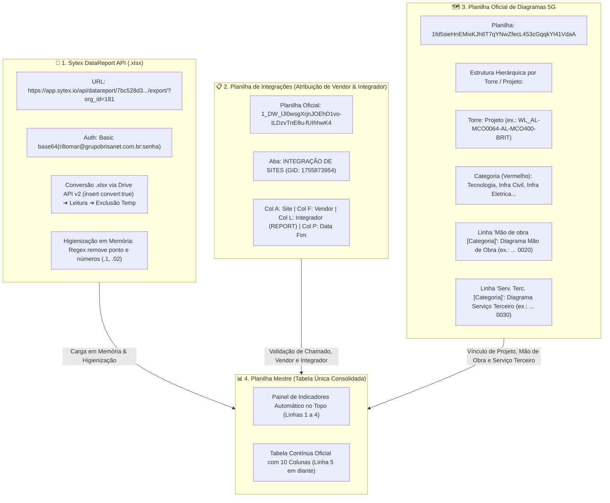

# 📐 Arquitetura da Nova Estratégia de Integrações & Diagramas 5G

> [!NOTE]
> Documento de planejamento e modelagem técnica da nova estratégia unificada para o módulo de integração de sites 5G, cruzamento de dados com a API Sytex (.xlsx) e consolidação em tabela única.

---

## 1. Mapeamento Geral do Fluxo Unificado



---

## 2. Ingestão da API Sytex (.xlsx) em Google Apps Script

Como o endpoint da API Sytex retorna um arquivo binário em formato **`.xlsx`**:
* **Pipeline de Ingestão Nativa:**
  1. O script faz o download do blob binário via `UrlFetchApp.fetch()` com cabeçalho de autenticação HTTP Basic.
  2. O blob é convertido temporariamente em uma planilha Google temporária via **Drive API v2** (`Drive.Files.insert` com parâmetro `{ convert: true }`).
  3. O script lê a primeira aba com `getSheets()[0].getDataRange().getValues()`.
  4. O arquivo temporário no Drive é **excluído imediatamente** (`Drive.Files.remove(tempId)`), garantindo que nada fique salvo ou ocupe espaço no Google Drive.
  5. Os dados são processados e higienizados 100% na memória RAM do Apps Script.

---

## 3. Estrutura da Base de Diagramas (Mapeamento do Layout Oficial)

A partir da estrutura da planilha de diagramas, mapeamos como cada elemento se relaciona:

```
[Linha Torre]      Torre: WL_AL-MCO0064-AL-MCO400-BRIT (Código do Projeto)
  ├── [Categoria]  Tecnologia - WL_AL-MCO0064-... ➔ 4055381 (Código Geral)
  │     ├── Materiais Tecnologia ........... ➔ 4055381 0010
  │     ├── Mão de obra Tecnologia ......... ➔ 4055381 0020 (Mão de Obra)
  │     └── Serv. Terc. Tecnologia ......... ➔ 4055381 0030 (Serviço Terceiro)
  ├── [Categoria]  Infra Civil - WL_AL-MCO0064-... ➔ 4055099
  │     ├── Materiais Civil ................ ➔ 4055099 0010
  │     ├── Mão de obra Civil .............. ➔ 4055099 0020
  │     └── Serv. Terc. Civil .............. ➔ 4055099 0030
```

### Regras de Extração dos Diagramas para a Tabela:
* **Frente / Categoria (Coluna 2):** Informa a categoria do diagrama consultado (ex.: `Tecnologia`, `Infra Civil`, `Infra Eletrica`, etc. — com padrão `Tecnologia` para integrações de sites).
* **Projeto (Coluna 7):** Extrai o código da Torre / Projeto associado ao site (ex.: `WL_AL-MCO0064-AL-MCO400-BRIT`).
* **Mão de Obra (Coluna 8):** Captura o diagrama da linha `Mão de obra [Categoria] - [SITE]` (ex.: `4055381 0020`).
* **Serviço Terceiro (Coluna 9):** Captura o diagrama da linha `Serv. Terc. [Categoria] - [SITE]` (ex.: `4055381 0030`).
* **Situação do Diagrama (Coluna 10):** Validação ou status do diagrama (`OK`, `Pendente`, `Em elaboração`).

---

## 4. Estrutura Oficial das 10 Colunas (Tabela Única)

A tabela de destino segue rigorosamente a ordem alinhada:

| Nº | Nome da Coluna | Origem do Dado | Exemplo |
| :-: | :--- | :--- | :--- |
| **1** | **Data de Finalização** | Planilha Integração (Col P) | `12/01/2026` |
| **2** | **Frente / Categoria** | Categoria do Diagrama | `Tecnologia` |
| **3** | **Código do Site** | Sytex API (Higienizado sem `.1`) | `MCO0064` |
| **4** | **Vendor** | Planilha Integração (Col F) | `HUAWEI` |
| **5** | **Integrador** | Planilha Integração (Col L `REPORT`) | `BRISANET` |
| **6** | **Chamado / Ticket** | Planilha Integração / Sytex | `TK-2026-004` |
| **7** | **Projeto** | Base de Diagramas (Linha Torre) | `WL_AL-MCO0064-AL-MCO400-BRIT` |
| **8** | **Mão de Obra (Diagrama)** | Base Diagramas (Linha Mão de Obra) | `4055381 0020` |
| **9** | **Serviço Terceiro (Diagrama)** | Base Diagramas (Linha Serv. Terc.) | `4055381 0030` |
| **10** | **Situação do Diagrama** | Base Diagramas / Validação | `OK` |

---

## 5. Painel de Indicadores Automático (Linhas 1 a 4 Fixadas)

No topo da aba mensal (ex.: `NOV/2026`), cartões de resumo calculam automaticamente a partir da tabela:

```
┌─────────────────────────────────┬─────────────────────────────────┬─────────────────────────────────┬─────────────────────────────────┐
│ 🟢 Integrado por nós (Brisanet) │ 🔵 Outros Vendors (Fiberhome)   │ 🟣 Demais Categorias            │ ⚪ Total Geral do Mês           │
│ =CONT.SE(E5:E; "BRISANET")      │ =CONT.SE(E5:E; "FIBERHOME")     │ =CONT.SE(E5:E; "<>")            │ =CONT.VALORES(C5:C)             │
└─────────────────────────────────┴─────────────────────────────────┴─────────────────────────────────┴─────────────────────────────────┘
```
