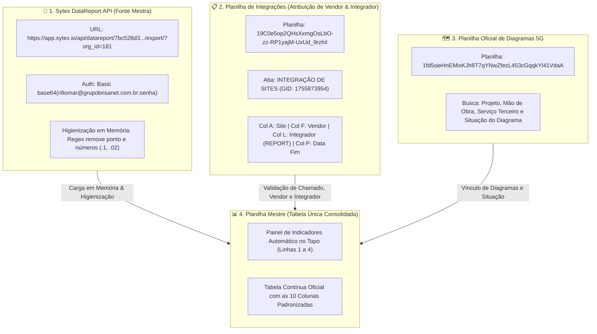

# 📐 Arquitetura da Nova Estratégia de Integrações & Diagramas 5G

> [!NOTE]
> Documento de planejamento e modelagem de dados da nova estratégia para o módulo de integração de sites 5G, cruzamento Sytex e consolidação em planilha única.

---

## 1. Mapeamento das Fontes de Dados e Integração



---

## 2. Decisão Arquitetural: Eliminação da Aba `comparativos`

Conforme alinhado, **a aba `comparativos` foi eliminada da arquitetura**:
* **Por que eliminar?** A aba comparativos gerava mais uma etapa intermediária manual/visual desnecessária.
* **Nova Abordagem:** O cruzamento entre os sites retornados pelo relatório do Sytex e os chamados da planilha de Integrações ocorre **100% em memória** no Google Apps Script.
* **Resultado:** Somente os registros válidos, higienizados, desduplicados e conciliados são gravados diretamente na aba oficial do mês, mantendo a planilha limpa e sem abas intermediárias.

---

## 3. Estrutura Oficial das 10 Colunas (Tabela Única)

A tabela de dados substitui os 7 blocos paralelos anteriores por uma estrutura contínua, permitindo ordenação e filtros nativos sem quebra de layout:

| Coluna | Nome do Cabeçalho | Origem da Informação | Regra / Descrição |
| :---: | :--- | :--- | :--- |
| **A** | **Data de Finalização** | Planilha Integração (Col P) | Data oficial de conclusão do chamado no mês da aba (ex.: `15/10/2026`) |
| **B** | **Frente / Categoria** | Classificação Operacional | Ex.: `Tecnologia - Integrado por nós`, `Tecnologia - Outros Vendors`, `Expansão RF`, `Expansão NOC` |
| **C** | **Código do Site** | Sytex API (Higienizado) | Código padronizado e limpo via Regex sem sufixo numérico (ex.: `BCE0007`, `TSA0028`) |
| **D** | **Vendor** | Planilha Integração (Col F) | Fabricante dos equipamentos (`HUAWEI`, `FIBERHOME`, `NOKIA`) |
| **E** | **Integrador** | Planilha Integração (Col L `REPORT`) | Quem realizou o serviço de integração (`BRISANET`, `FIBERHOME`, `HUAWEI`) |
| **F** | **Chamado / Ticket** | Planilha Integração / Sytex | Número identificador do chamado/protocolo de integração |
| **G** | **Projeto** | Base Diagramas / Integração | Código do projeto vinculado (ex.: `EXP-WL_RM1001-RN-...` para frentes de Expansão) |
| **H** | **Mão de Obra (Diagrama)** | Base Diagramas 5G | Código do diagrama de rede para Mão de Obra (ex.: `4023987 0020`) |
| **I** | **Serviço Terceiro (Diagrama)** | Base Diagramas 5G | Código do diagrama para Serviços de Terceiros (quando aplicável) |
| **J** | **Situação do Diagrama** | Base Diagramas 5G | Situação de validação do diagrama (`OK`, `Pendente`, `Em elaboração`) |

---

## 4. Painel de Indicadores no Topo da Aba (Linhas 1 a 4 Fixadas)

Para manter a visibilidade gerencial que existia nos blocos antigos, o topo da aba mensal (ex.: `NOV/2026`) conterá cartões automáticos consolidados:

```
┌─────────────────────────────────┬─────────────────────────────────┬─────────────────────────────────┬─────────────────────────────────┐
│ 🟢 Integrado por nós (Brisanet) │ 🔵 Outros Vendors (Fiberhome)   │ 🟣 Expansão (RF / NOC)          │ ⚪ Total Geral do Mês           │
│ =CONT.SE(E:E; "BRISANET")       │ =CONT.SE(E:E; "FIBERHOME")      │ =CONT.SE(B:B; "*Expansão*")     │ =CONT.VALORES(C5:C)             │
└─────────────────────────────────┴─────────────────────────────────┴─────────────────────────────────┴─────────────────────────────────┘
```

---

## 5. Especificação do Conector Sytex API

* **URL do DataReport:** `https://app.sytex.io/api/datareport/7bc528d3-2b34-4bc1-b6df-59eff2ccceb9/export/?org_id=181`
* **Método HTTP:** `GET`
* **Autenticação:** HTTP Basic Auth:
  ```javascript
  const headers = {
    "Authorization": "Basic " + Utilities.base64Encode(usuario + ":" + senha)
  };
  ```
* **Processamento do Retorno:**
  * O arquivo retornado (CSV/JSON) é processado diretamente pelo Apps Script.
  * Os códigos de site passam pela função de higienização Regex:
    ```javascript
    function higienizarCodigoSite(codigoBruto) {
      if (!codigoBruto) return "";
      return codigoBruto.toString().trim().replace(/\.\d+.*$/, '').toUpperCase();
    }
    ```
  * Cruzamento com a planilha de integração:
    * Valida se o site existe na aba `INTEGRAÇÃO DE SITES`.
    * Confirma se o chamado foi finalizado no mês correspondente (Coluna P).
    * Extrai o **Vendor** (Coluna F) e o **Integrador** (Coluna L).
    * Descarta linhas com Coluna L vazia.
    * Busca diagramas na base 5G e grava na tabela unificada.

---

## 6. Próximos Passos (Aguardando Aprovação para Codificação)

1. **Validação do formato de resposta do Sytex:**
   * Confirmar se o endpoint `https://app.sytex.io/api/datareport/.../export/` retorna CSV ou JSON.
2. **Definição da regra da coluna `Frente / Categoria`:**
   * Definir se o preenchimento de `Frente / Categoria` (Coluna B) é derivado automaticamente do Integrador (ex.: se Integrador for Brisanet $\rightarrow$ `Tecnologia - Integrado por nós`; se Fiberhome $\rightarrow$ `Tecnologia - Outros Vendors`), ou se vem de outro campo.
3. **Autorização para Início da Implementação:**
   * Assim que você aprovar esse mapeamento, passaremos para a fase de desenvolvimento do script no `Codigo.js`.
