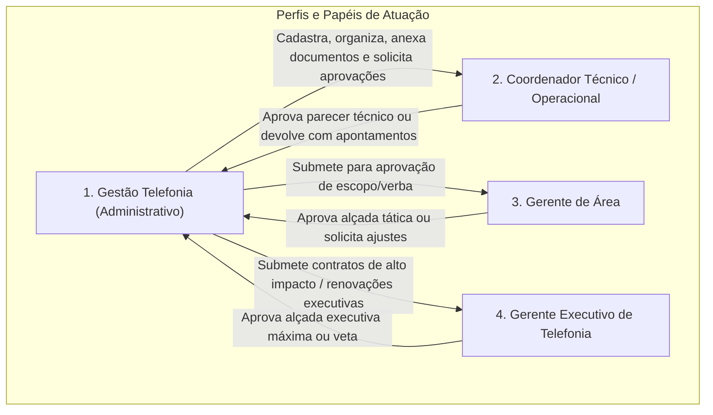
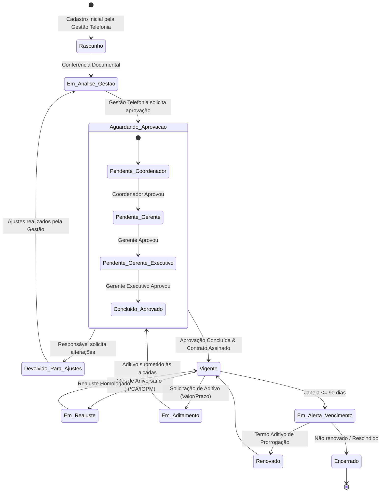
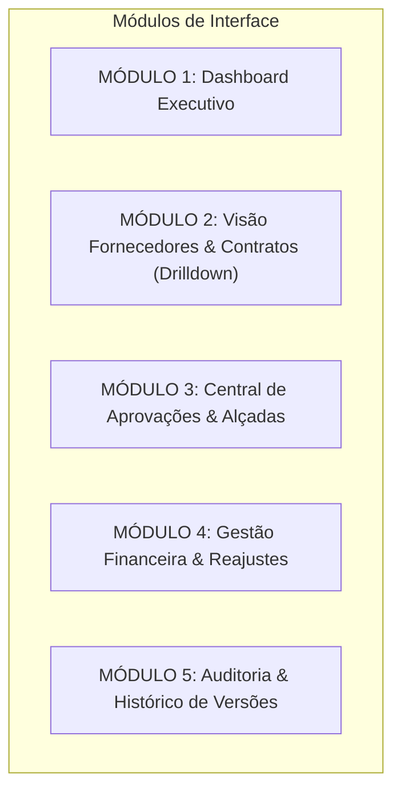
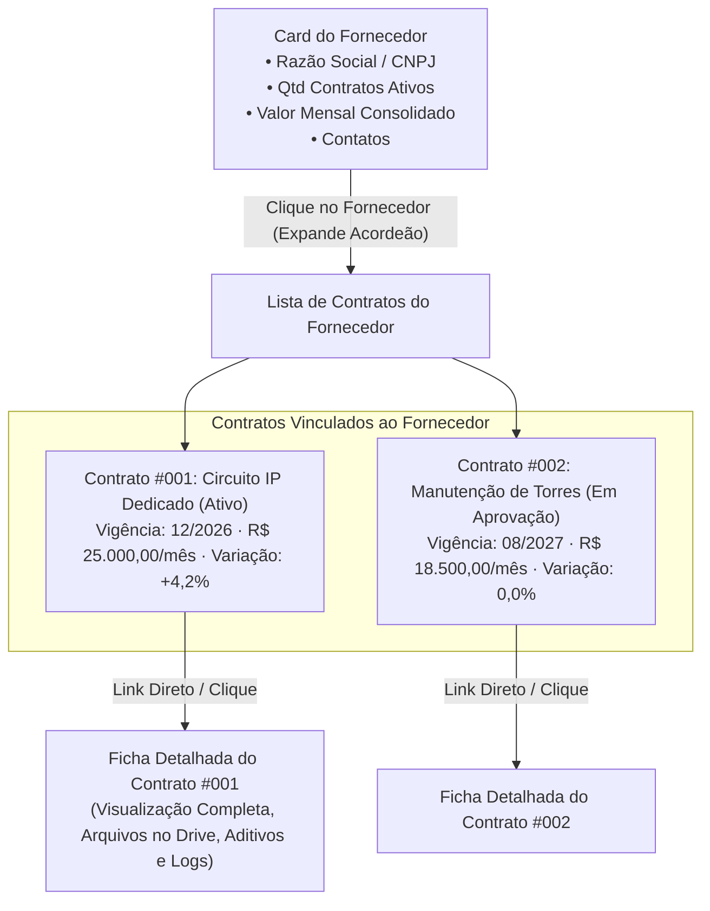
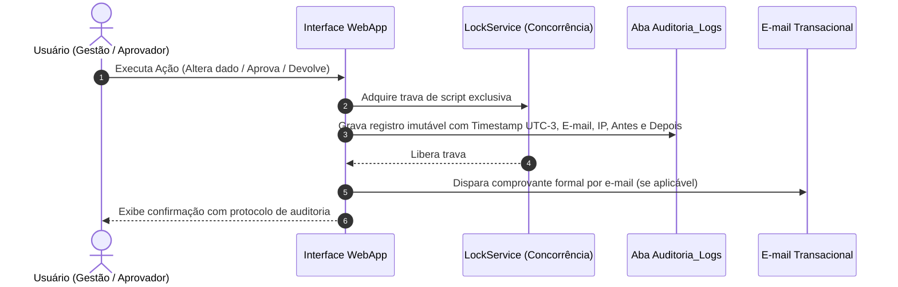

# Desenho de Arquitetura: Sistema de Gestão de Contratos
**Gerência Executiva de Telefonia - Grupo Brisanet**

---

## 1. Escopo e Diretrizes Fundamentais

*   **Público-Alvo e Abrangência:** Operação exclusiva da **Gerência Executiva de Telefonia**.
*   **Diretriz Operacional:** Nenhuma linha de código será desenvolvida antes da validação completa e aprovação formal deste documento de arquitetura.
*   **Repositório de Arquivos:** Criação de uma **nova pasta raiz dedicada no Google Drive**, estruturada hierarquicamente por fornecedor e, internamente, por contrato e tipo de documento.
*   **Modelo de Governança:** O setor administrativo (**Gestão Telefonia**) atua como operador central, com esteira de solicitação e tramitação de aprovações formais de **Coordenadores, Gerentes e Gerentes Executivos**.
*   **Trilha Oficial de Auditoria e Governança:** Registro imutável de todas as ações (quem realizou, quando, qual campo/decisão, valor anterior e novo valor), servindo como histórico comprobatório institucional.
*   **Experiência de Navegação Centrada no Fornecedor:** Apresentação em cartões/acordeões de fornecedores que expandem para exibir todos os seus contratos associados com links diretos de acesso rápido.

---

## 2. Atores e Níveis de Acesso (RBAC)



### 2.1 Descrição das Responsabilidades
1.  **Gestão Telefonia (Administrador Operacional):**
    *   Cadastro inicial de fornecedores e contratos.
    *   Upload, classificação e arquivamento de documentos no Drive.
    *   Acompanhamento diário de vigências, prazos e reajustes.
    *   Disparo formal de solicitações de aprovação ou revisões aos responsáveis.
2.  **Coordenadores (Aprovadores Técnicos):**
    *   Aprovação técnica do escopo, volumetria de circuitos/serviços e relatórios de medição.
3.  **Gerentes (Aprovadores Táticos / Orçamentários):**
    *   Aprovação orçamentária dos centros de custo sob sua gestão e validação de aditivos de valor/prazo.
4.  **Gerente Executivo (Aprovador Estratégico):**
    *   Validação final de novos contratos de grande porte, contratos estratégicos de telecomunicações e rescisões.

---

## 3. Taxonomia e Estrutura no Google Drive

A nova estrutura de arquivos será padronizada e criada programaticamente pelo sistema no Google Drive, isolada de pastas legadas:

```
[DRIVE RAIZ] Contratos - Gerência Executiva de Telefonia/
│
├── 00_Configuracoes_e_Modelos/
│   ├── Modelos_Minutas/
│   └── Formularios_Padrao/
│
├── {NOME_FORNECEDOR_A}/
│   ├── CT-{ANO}-{ID_0001} - {Objeto_Resumido}/
│   │   ├── 01_Contrato_Principal/          (Minutas e documento assinado)
│   │   ├── 02_Termos_Aditivos/             (Aditivos de valor, prazo ou escopo)
│   │   ├── 03_Documentos_Tecnicos/         (Propostas, SLAs, certidões)
│   │   ├── 04_Boletins_Medicao/            (Medições mensais e entregáveis)
│   │   └── 05_Aprovacoes_e_Pareceres/      (Evidências e registros formais)
│   │
│   └── CT-{ANO}-{ID_0002} - {Objeto_Resumido}/
│       └── ...
│
└── {NOME_FORNECEDOR_B}/
    └── ...
```

---

## 4. Esteira de Trabalho e Ciclo de Vida do Contrato



---

## 5. Módulos do Sistema e Arquitetura de Telas

O sistema é estruturado em **5 módulos de trabalho especializados**, com navegação lateral contínua:



### 5.1 Módulo 1: Dashboard Executivo
*   **KPIs no Topo da Tela:**
    *   Total de Contratos Ativos da Telefonia.
    *   Valor Comprometido Anual (Orçamento da Gerência).
    *   Previsão de Desembolso no Mês Corrente.
    *   Contratos em Risco Imediato (Vencimento < 60 dias).
    *   Minhas Aprovações Pendentes (Contador personalizado para quem estiver conectado).
*   **Gráficos Integrados:**
    *   Curva de Desembolso Financeiro (Previsão mês a mês para 12/24 meses).
    *   Concentração de Gastos por Fornecedor (Top Parceiros da Telefonia).
    *   Semaforização de Vencimentos em faixas temporais (< 30d, 31-60d, 61-90d, 91-180d).

---

### 5.2 Módulo 2: Visão Fornecedores & Contratos (Modelo Acordeão / Drilldown)

Conforme a diretriz visual definida, a experiência principal não é uma lista solta de contratos, mas um **painel corporativo centrado no fornecedor**:



#### Elementos do Card do Fornecedor:
*   **Cabeçalho do Fornecedor:**
    *   Identificação: Razão Social e Nome Fantasia.
    *   CNPJ formatado e Status de Homologação (Ativo, Em Homologação, Bloqueado).
    *   Chips Resumo: Quantidade total de contratos vigentes e valor total mensal desembolsado para o fornecedor.
    *   Ações Rápidas: Botão para abrir a pasta do fornecedor diretamente no Google Drive e botão "Novo Contrato para este Fornecedor".
*   **Conteúdo Expandido ao Clicar (Drilldown de Contratos):**
    *   Tabela/Cards com os contratos do fornecedor:
        *   `#ID` e Protocolo Oficial (BRISA-TEL-{ANO}-{ID}).
        *   Objeto resumido do contrato.
        *   Data de término da vigência com alerta visual de prazo restante.
        *   Valor mensal atual.
        *   Variação de valor de um mês para o outro (MoM).
        *   Status do Contrato (Vigente, Em Aprovação, Em Reajuste).
        *   Status de Alçada (Pendente Coordenador, Pendente Gerente, Aprovado).
        *   **Link Direto de Acesso:** Botão destacado "Abrir Ficha do Contrato" que exibe a visão 360° do contrato selecionado.

#### Ficha 360° do Contrato Selecionado:
*   **Aba 1 - Dados Gerais:** Objeto, centro de custo, tipo, gerentes e contatos.
*   **Aba 2 - Financeiro & Reajustes:** Moeda, valor original, valor atualizado, variação mês a mês, índice (IPCA/IGPM), histórico de parcelas e competências.
*   **Aba 3 - Documentos & Anexos no Drive:** Visualizador de arquivos contidos na pasta do contrato no Google Drive com separação por tipo (Contrato Principal, Aditivos, Documentos Técnicos, Boletins de Medição) e botão de upload.
*   **Aba 4 - Termos Aditivos:** Histórico acumulado de aditivos de valor e prazo, com percentual de acréscimo contra o valor original.
*   **Aba 5 - Registro Oficial de Auditoria & Aprovações:** Trilha completa com data, hora, responsável e parecer de cada ação do contrato.

---

### 5.3 Módulo 3: Central de Solicitação e Registro de Aprovações

*   **Ação da Gestão Telefonia (Solicitar Aprovação):**
    *   Botão na ficha do contrato: "Submeter para Aprovação".
    *   Seleção da alçada necessária (Coordenador, Gerente ou Gerente Executivo).
    *   Campo para inserção da Justificativa Técnica/Operacional.
    *   Anexo automático dos documentos em análise.
    *   Disparo de e-mail institucional estruturado com link direto para o contrato.
*   **Ação do Aprovador (Coordenador / Gerente / Gerente Executivo):**
    *   Visualização simplificada contendo: Objeto, Fornecedor, Valor Mensal, Impacto Orçamentário, Vigência e Documentos.
    *   Duas opções de decisão:
        1.  **Aprovar:** Registra aceite digital formal, data/hora e justificativa facultativa.
        2.  **Solicitar Ajustes (Devolver):** Abre campo obrigatório para descrever os apontamentos técnicos ou jurídicos necessários. O contrato retorna imediatamente para a Gestão Telefonia com status "Devolvido para Ajustes".

---

### 5.4 Módulo 4: Gestão Financeira, Reajustes e Aditivos
*   **Matriz de Competências Mês a Mês:** Visão em grade das parcelas mensais de cada contrato ao longo do ano orçamentário.
*   **Módulo de Reajuste Anual:**
    *   Identificação automática dos contratos que atingem o mês de aniversário.
    *   Aplicação dos índices homologados (IPCA, IGP-M, INPC ou índice contratual específico).
    *   Simulador de impacto financeiro antes da confirmação da nova tarifa.
*   **Módulo de Aditivos:**
    *   Registro de termos aditivos vinculados ao contrato-mãe.
    *   Cálculo automático do novo valor mensal e nova data de término.
    *   Garantia de integridade do histórico acumulado.

---

### 5.5 Módulo 5: Trilha Oficial de Auditoria e Governança

Para atender à exigência de registros oficiais institucionais de todas as ações:



#### Características da Trilha Oficial:
*   **Imutabilidade:** Registros gravados em ordem estritamente cronológica, sem opção de exclusão ou edição pela interface.
*   **Campos do Registro Oficial:**
    *   `Timestamp`: Data e hora exatas no Horário de Brasília (UTC-3).
    *   `Responsável`: E-mail corporativo autenticado do Google Workspace.
    *   `Papel`: Gestor Administrativo, Coordenador, Gerente ou Gerente Executivo.
    *   `Entidade e Registro`: Contrato `#ID` ou Termo Aditivo `#ID`.
    *   `Tipo de Ação`: Criação, Edição de Campo Individual, Submissão de Aprovação, Parecer Favorável, Solicitação de Ajustes, Aplicação de Reajuste, Upload de Documento.
    *   `Valor Anterior vs. Novo Valor`: Rastreamento exato de valores modificados.
    *   `Parecer / Justificativa Oficial`: Texto registrado pelo responsável no momento da ação.
*   **Certificado de Auditoria do Contrato:**
    *   Na ficha de cada contrato haverá o botão "Gerar Folha de Rosto / Certificado de Auditoria", exportando em PDF ou visualização para impressão a cronologia oficial de todas as decisões tomadas naquele contrato.

---

## 6. Modelo Relacional de Dados (Estrutura da Planilha Backend)

### Aba 1: `Contratos` (Cadastro Central)
*   `id_contrato` (PK): Código identificador único (ex: CT-TEL-0001).
*   `protocolo_oficial`: BRISA-TEL-{ANO}-{ID}.
*   `id_fornecedor` (FK): Vínculo ao fornecedor.
*   `objeto_contrato`: Descrição completa do serviço.
*   `tipo_contrato`: Voz, Dados/Link, Infraestrutura, Torres, Licenciamento, Manutenção.
*   `status`: Rascunho, Em Análise, Aguardando Aprovação, Aprovado, Vigente, Em Reajuste, Encerrado.
*   `data_inicio_vigencia`: Data inicial.
*   `data_fim_vigencia`: Data final (ou em branco se indeterminada).
*   `vigencia_indeterminada`: Sim/Não.
*   `aviso_previo_dias`: Prazo para manifestação de rescisão (ex: 30, 60, 90).
*   `valor_mensal_base`: Valor por lançamento inicial.
*   `valor_mensal_atual`: Valor após reajustes e aditivos.
*   `variacao_mes_a_mes_valor`: Diferença monetária apurada entre competências.
*   `variacao_mes_a_mes_percentual`: Percentual de variação.
*   `indice_reajuste`: IPCA, IGP-M, INPC, Fixo, Sem Reajuste.
*   `mes_aniversario_reajuste`: Mês de aniversário para aplicação (1 a 12).
*   `centro_custo`: Centro de custo pagador.
*   `conta_contabil`: Conta contábil.
*   `gestor_tecnico_email`: Responsável operacional pelo contrato.
*   `id_pasta_drive`: ID oficial da pasta do contrato no Google Drive.
*   `id_pasta_fornecedor_drive`: ID da pasta do fornecedor no Google Drive.
*   `observacoes`: Notas operacionais da Gestão Telefonia.

### Aba 2: `Fornecedores` (Base de Parceiros)
*   `id_fornecedor` (PK): Código do fornecedor.
*   `razao_social`: Razão social oficial.
*   `nome_fantasia`: Nome fantasia conhecido na Telefonia.
*   `cnpj`: CNPJ formatado.
*   `contato_comercial`: Nome e telefone do gestor da conta.
*   `email_comercial`: E-mail oficial para notificações e renovações.
*   `id_pasta_drive_fornecedor`: ID da pasta do fornecedor no Drive.
*   `status`: Ativo, Inativo, Em Homologação.

### Aba 3: `Aprovacoes_Workflow` (Esteira de Alçadas)
*   `id_aprovacao` (PK): Identificador único da solicitação.
*   `id_contrato` (FK): Contrato em tramitação.
*   `id_aditivo` (FK, opcional): Aditivo associado, se for o caso.
*   `tipo_solicitacao`: Novo Contrato, Aditivo de Valor, Prorrogação de Prazo, Rescisão.
*   `solicitante_email`: Usuário da Gestão Telefonia que solicitou.
*   `data_solicitacao`: Timestamp do envio.
*   `aprovador_designado_email`: E-mail do Coordenador, Gerente ou Gerente Executivo.
*   `nivel_alcada`: Coordenador / Gerente / Gerente Executivo.
*   `status_decisao`: Pendente, Aprovado, Ajustes Solicitados.
*   `data_decisao`: Timestamp da resposta do aprovador.
*   `justificativa_solicitante`: Texto da justificativa técnica de envio.
*   `parecer_aprovador`: Parecer ou apontamentos de ajustes registrados.

### Aba 4: `Aditivos` (Histórico de Modificações Contratuais)
*   `id_aditivo` (PK): Código identificador do aditivo.
*   `id_contrato` (FK): Contrato-mãe.
*   `numero_termo`: 1º Termo Aditivo, 2º Termo Aditivo, etc.
*   `tipo_aditivo`: Valor (Acréscimo/Supressão), Prazo (Vigência), Misto.
*   `valor_alteracao`: Valor financeiro alterado (+ ou -).
*   `nova_vigencia_fim`: Nova data de término acordada.
*   `justificativa_aditivo`: Resumo do motivo do aditamento.
*   `data_celebracao`: Data de assinatura.
*   `id_arquivo_drive`: ID do documento do aditivo assinado no Drive.
*   `status_aprovacao`: Aprovado, Pendente.

### Aba 5: `Acessos_Alcadas` (Controle de Usuários e Permissões)
*   `id_usuario` (PK): E-mail institucional.
*   `nome_completo`: Nome do colaborador.
*   `papel`: Gestão Telefonia (Admin), Coordenador, Gerente, Gerente Executivo, Visualizador.
*   `notificacoes_alertas`: Sim/Não para recebimento da régua de vencimentos.
*   `status`: Ativo / Inativo.

### Aba 6: `Auditoria_Logs` (Trilha Imutável Oficial)
*   `id_log` (PK): Sequencial automático imutável.
*   `timestamp`: Data/hora em Horário de Brasília (UTC-3).
*   `usuario_email`: E-mail corporativo autenticado.
*   `papel_usuario`: Papel do usuário no momento da ação.
*   `entidade`: Contrato, Fornecedor, Aditivo, Aprovação.
*   `id_registro`: ID do elemento modificado.
*   `acao`: Criação, Edição de Campo, Envio para Aprovação, Aprovação Formal, Devolução com Ajustes, Reajuste Aplicado, Upload de Arquivo.
*   `campo_afetado`: Nome do campo alterado (ou etapa de workflow).
*   `valor_anterior`: Snapshot do dado antes da alteração.
*   `novo_valor`: Snapshot do dado gravado.
*   `justificativa_parecer`: Parecer ou justificativa fornecida pelo responsável.

---

## 7. Identidade Visual, Tipografia e Design System (a brisanet)

A interface seguirá estritamente o guia de marca oficial da **brisanet**, garantindo sofisticação corporativa, legibilidade e comunicação visual concisa:

### 7.1 Regras de Expressão da Marca
*   **Tratamento no Feminino:** Toda menção institucional refere-se no feminino: **a brisanet**.
*   **Grafia Oficial da Marca:** A grafia é feita sempre em caixa baixa: **brisanet** ou **brisa**.
*   **Zero Emojis:** Proibição estrita de qualquer emoji em interfaces, títulos, relatórios, modais ou mensagens de sistema. A sinalização é feita exclusivamente por ícones vetoriais monocromáticos (SVGs), tipografia e cores semânticas.
*   **Microcopy Direto e Objetivo:** Textos curtos, diretos e sem prolixidade ("sem textos robustos"). Prioridade para dados escaneáveis, números destacados, chips de status compactos e rótulos objetivos.

### 7.2 Tipografia Oficial
*   **Fonte Primária:** `Figtree` (Google Fonts) para todos os elementos de interface, títulos e dados numéricos.
*   **Fonte Secundária / Alternativa:** `Rubik` (Google Fonts).
*   **Hierarquia Tipográfica:**
    *   Títulos de Seção / Módulos: 18px a 20px, Peso 700 (Bold), cor `#0B316D`.
    *   Subtítulos e Cards: 14px a 15px, Peso 600 (Semi-bold), cor `#1e293b`.
    *   Rótulos de Campos (Labels): 11px a 12px, Peso 600, Caixa Alta ou Capitalizado, cor `#64748b`.
    *   Valores e Indicadores Financeiros: 14px a 16px, Peso 700, alinhamento numérico tabular.
    *   Textos de Apoio / Ajuda: 11px a 12px, Peso 400 (Regular), cor `#94a3b8`.

### 7.3 Paleta de Cores Oficial

```
+---------------------------------------------------------------------------------+
| CORES PRIMÁRIAS                                                                 |
| [ #FF5022 ] Laranja Principal     (Ações Primárias, Botões Principais, Destaque) |
| [ #2242D4 ] Azul Principal        (Navegação, Links Ativos, Elementos de Apoio) |
| [ #E8E8E8 ] Cinza Claro           (Bordas Neutras, Divisores, Fundos Secundários)|
+---------------------------------------------------------------------------------+
| CORES SECUNDÁRIAS E SEMÂNTICAS                                                  |
| [ #0B316D ] Azul Escuro / Marinho (Cabeçalhos, Barra Lateral, Títulos Fortes)  |
| [ #D0FF60 ] Verde Limão           (Status Ativo, Sucesso, Indicadores Positivos)|
| [ #E47D20 ] Laranja Médio         (Atenção, Vencimentos Intermediários 60d)     |
| [ #E89650 ] Pêssego / Laranja     (Chips Auxiliares, Categorias Secundárias)    |
| [ #9F4016 ] Terracota Escuro      (Alertas Críticos, Vencimento <= 30d, Risco)   |
| [ #DA2468 ] Magenta / Rosa        (Rescisões, Cancelamentos, Bloqueios)         |
+---------------------------------------------------------------------------------+
```

### 7.4 Diretrizes de Estilo dos Componentes Visuais
*   **Cards de Fornecedores e Contratos:** Fundo branco puro (`#FFFFFF`), borda fina sutil de 1px em `#E8E8E8`, cantos arredondados de 8px a 10px, sombra suave de repouso (`box-shadow: 0 1px 3px rgba(0,0,0,0.06)`).
*   **Badges e Tags:** Altura reduzida (22px a 24px), cantos em pílula (arredondamento completo), tipografia de 11px em peso 700, texto centralizado e cores com contraste WCAG AA.
*   **Tabelas e Acordeões:** Linhas com altura de 44px a 48px, efeito de hover suave em `#F8FAFC`, linhas divisórias em `#F1F5F9` e chevron de expansão discreto em vetor SVG.

---

## 8. Roteiro de Validação e Próximos Passos

Com a incorporação da visão por fornecedor em acordeão, da trilha oficial de auditoria e do guia de estilo da **brisanet**, os passos para aprovação formal do desenho são:

1.  **Validação da Navegação:** Confirmação de que o modelo de drilldown (Fornecedor -> Contratos Vinculados -> Ficha 360°) atende perfeitamente ao fluxo de trabalho diário da equipe.
2.  **Validação dos Registros Oficiais:** Confirmação de que a estrutura de logs imutáveis e a geração da folha de rosto de auditoria atendem às exigências de conformidade da Gerência.
3.  **Validação do Design System:** Confirmação de que as regras tipográficas (Figtree/Rubik), paleta de cores (primárias `#FF5022`, `#2242D4`, `#E8E8E8` e secundárias) e estilo conciso e direto atendem aos padrões institucionais da marca.
4.  **Autorização para Início da Fase 1:** Assim que autorizado formalmente, iniciaremos a criação da nova pasta raiz no Google Drive, o provisionamento das abas relacionais na planilha e a estruturação dos componentes visuais.
