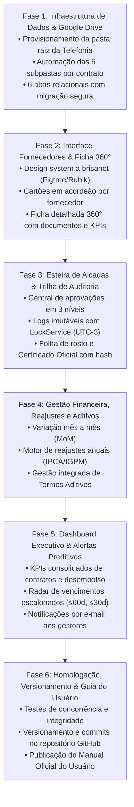

# Plano de Execução Passo a Passo: Sistema de Gestão de Contratos
**Gerência Executiva de Telefonia - Grupo Brisanet**

---

## 1. Visão Geral do Roteiro de Execução

Este documento formaliza o roteiro sequencial de implantação do novo Sistema de Gestão de Contratos para a Gerência Executiva de Telefonia do Grupo Brisanet. O projeto estabelece uma infraestrutura corporativa robusta com governança por alçadas, trilha oficial de auditoria imutável e organização de documentos no Google Drive.

---

## 2. Detalhamento das Fases

### Fase 1: Infraestrutura de Dados e Google Drive
*   **Pasta Raiz Dedicada:** `Contratos - Gerência Executiva de Telefonia`.
*   **Subpasta de Modelos:** `00_Configuracoes_e_Modelos`.
*   **Estrutura por Contrato:** Pasta do Fornecedor &rarr; Pasta do Contrato (`CT-{ANO}-{ID} - {Objeto}`) &rarr; 5 subpastas padronizadas:
    1. `01_Contrato_Principal`
    2. `02_Termos_Aditivos`
    3. `03_Documentos_Tecnicos`
    4. `04_Boletins_Medicao`
    5. `05_Aprovacoes_e_Pareceres`
*   **Banco Relacional (Google Sheets):**
    *   `Contratos` (Cadastro mestre e indicadores)
    *   `Fornecedores` (Base de parceiros e links de Drive)
    *   `Aprovacoes_Workflow` (Esteira de alçadas)
    *   `Aditivos` (Histórico de aditamentos contratuais)
    *   `Acessos_Alcadas` (Controle de perfis e permissões)
    *   `Auditoria_Logs` (Trilha oficial e imutável)

### Fase 2: Interface Centrada no Fornecedor (Drilldown)
*   **Design System:** Identidade visual `a brisanet`, fontes Google Fonts `Figtree` e `Rubik`, paleta oficial primária (`#FF5022`, `#2242D4`, `#E8E8E8`) e secundárias (`#0B316D`, `#D0FF60`, `#E47D20`, `#E89650`, `#9F4016`, `#DA2468`). Estritamente **zero emojis**.
*   **Navegação Acordeão:** Listagem principal apresentando cada fornecedor com seus KPIs agregados (quantidade de contratos e valor mensal total) e link direto para sua pasta no Drive. Ao clicar no fornecedor, expande os contratos vinculados.
*   **Ficha 360° do Contrato:** Drawer/Modal com 5 abas temáticas (Resumo & Cadastro, Financeiro & Reajustes, Documentos no Drive, Termos Aditivos, Auditoria & Certificado).

### Fase 3: Esteira de Alçadas de Aprovação & Governança
*   **Três Níveis Formais de Alçada:**
    *   `Coordenador`: Aprovação técnica/operacional.
    *   `Gerente`: Validação de área e orçamento.
    *   `Gerente Executivo`: Validação estratégica e novos contratos de grande porte.
*   **Operador:** `Gestão Telefonia` (setor administrativo responsável pelo cadastro e submissão).
*   **Ações do Aprovador:**
    *   `Aprovar`: Grava aprovação com chancela digital e avança status.
    *   `Solicitar Ajustes`: Exige parecer obrigatório com apontamentos e retorna o contrato para a Gestão Telefonia.
*   **Auditoria Imutável:** Gravação com `LockService` garantindo data/hora no Horário de Brasília (UTC-3), e-mail corporativo autenticado, papel, antes, depois e justificativa.
*   **Certificado Oficial de Auditoria:** Geração de folha de rosto com hash criptográfico SHA-256 para impressão e anexação oficial.

### Fase 4: Gestão Financeira, Reajustes e Aditivos
*   Acompanhamento da variação mês a mês (MoM) em valor monetário e percentual.
*   Controle de aniversário de reajuste com base em índices contratuais (IPCA, IGP-M, INPC ou Fixo).
*   Averbação de termos aditivos de valor e vigência com atualização automática no contrato-mãe.

### Fase 5: Dashboard Executivo e Alertas Preditivos
*   Visualização imediata dos 6 KPIs principais no topo do sistema.
*   Filtros inteligentes por fornecedor, status e nível de alçada.
*   Disparo transacional de e-mails de solicitação de aprovação, conclusão e alerta de prazos.

### Fase 6: Homologação e Guia Oficial do Usuário
*   Auditoria de integridade e validação de sintaxe.
*   Versionamento completo no GitHub (`https://github.com/Rodrihenrique/orcamento-fpa.git`).
*   Disponibilização do manual passo a passo (`MANUAL_DO_USUARIO.md`) para a equipe de Telefonia.
